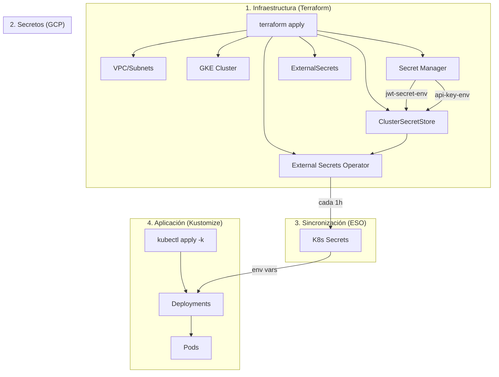
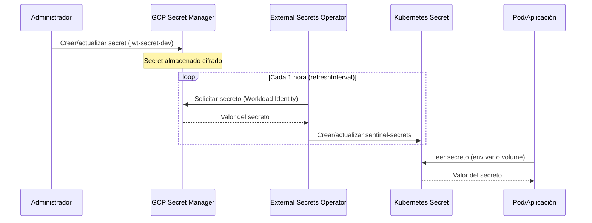

# Guía de Deployment

Esta guía describe el proceso completo para desplegar Sentinel Platform en GCP/GKE.

## Arquitectura de Deployment



## Flujo de Secrets



## Requisitos Previos

### Herramientas Necesarias

```bash
# Verificar versiones
gcloud --version          # >= 450.0.0
terraform --version       # >= 1.5.0
kubectl version --client  # >= 1.28
```

### APIs de GCP Habilitadas

```bash
gcloud services enable \
  container.googleapis.com \
  compute.googleapis.com \
  storage.googleapis.com \
  secretmanager.googleapis.com \
  iam.googleapis.com \
  --project=TU_PROYECTO_ID
```

## Paso 1: Desplegar Infraestructura con Terraform

```bash
cd infra/terraform/environments/dev

# Inicializar Terraform
terraform init

# Revisar el plan
terraform plan -var="project_id=TU_PROYECTO_ID"

# Aplicar (esto puede tardar ~15-20 minutos)
terraform apply -var="project_id=TU_PROYECTO_ID"
```

Terraform creará:
- VPC con subredes privadas
- Cluster GKE privado
- Buckets de Cloud Storage
- Service Accounts con Workload Identity
- Secrets en Secret Manager (vacíos)
- External Secrets Operator
- ClusterSecretStore y ExternalSecrets

## Paso 2: Configurar Valores de Secrets

Después de `terraform apply`, añade los valores reales a los secrets:

```bash
export PROJECT_ID=tu-proyecto-id
export ENVIRONMENT=dev

# JWT Secret (genera uno seguro)
JWT_SECRET=$(openssl rand -base64 32)
echo -n "$JWT_SECRET" | gcloud secrets versions add jwt-secret-${ENVIRONMENT} \
  --data-file=- --project=${PROJECT_ID}

# API Key (genera una segura)
API_KEY=$(openssl rand -hex 24)
echo -n "$API_KEY" | gcloud secrets versions add api-key-${ENVIRONMENT} \
  --data-file=- --project=${PROJECT_ID}
```

## Paso 3: Configurar kubectl

```bash
# Obtener credenciales del cluster
gcloud container clusters get-credentials sentinel-cluster \
  --region europe-west1 \
  --project TU_PROYECTO_ID

# Verificar conexión
kubectl cluster-info
kubectl get nodes
```

## Paso 4: Configurar Overlays de Kustomize

Actualiza el `PROJECT_ID` en los overlays:

```bash
# Opción 1: Editar manualmente
# Edita k8s/overlays/dev/kustomization.yaml y reemplaza PROJECT_ID

# Opción 2: Usar sed (Linux/Mac)
sed -i "s/PROJECT_ID/tu-proyecto-id/g" k8s/overlays/dev/kustomization.yaml

# Opción 3: Usar sed (Mac)
sed -i '' "s/PROJECT_ID/tu-proyecto-id/g" k8s/overlays/dev/kustomization.yaml
```

## Paso 5: Verificar Sincronización de Secrets

Antes de desplegar la aplicación, verifica que ESO esté funcionando:

```bash
# Verificar ESO está corriendo
kubectl get pods -n external-secrets

# Verificar ClusterSecretStore está Ready
kubectl get clustersecretstore
# NAME                  AGE   STATUS   CAPABILITIES   READY
# gcp-secret-manager    5m    Valid    ReadOnly       True

# Verificar ExternalSecrets están sincronizados
kubectl get externalsecrets -A
# NAMESPACE   NAME              STORE                REFRESH   STATUS         READY
# platform    sentinel-secrets  gcp-secret-manager   1h        SecretSynced   True
# ml          sentinel-secrets  gcp-secret-manager   1h        SecretSynced   True

# Verificar secrets K8s existen
kubectl get secrets sentinel-secrets -n platform
kubectl get secrets sentinel-secrets -n ml
```

## Paso 6: Desplegar Aplicación

```bash
# Opción 1: Usar el script de deployment
./scripts/deploy-k8s.sh dev

# Opción 2: kubectl directo
kubectl apply -k k8s/overlays/dev

# Verificar deployment
kubectl get pods -n platform
kubectl get pods -n ml
```

### Validar Antes de Aplicar (Dry Run)

```bash
# Validar manifiestos sin aplicar
./scripts/deploy-k8s.sh dev --dry-run

# O con kubectl
kubectl apply -k k8s/overlays/dev --dry-run=client
```

## Paso 7: Verificación Post-Deployment

```bash
# Verificar pods
kubectl get pods -n platform
kubectl get pods -n ml

# Ver logs
kubectl logs -f deployment/sentinel-api -n platform

# Verificar que los secrets están disponibles en el pod
kubectl exec -it deployment/sentinel-api -n platform -- env | grep -E "JWT|API"

# Port forward para testing local
kubectl port-forward svc/sentinel-api 8000:80 -n platform

# Test endpoint
curl http://localhost:8000/health
```

## Resumen de Comandos

| Paso | Comando |
|------|---------|
| Desplegar infra | `terraform apply -var="project_id=XXX"` |
| Añadir secrets | `gcloud secrets versions add ...` |
| Obtener kubeconfig | `gcloud container clusters get-credentials ...` |
| Configurar overlay | `sed -i 's/PROJECT_ID/xxx/g' k8s/overlays/dev/kustomization.yaml` |
| Desplegar app | `./scripts/deploy-k8s.sh dev` |
| Ver pods | `kubectl get pods -n platform` |
| Ver logs | `kubectl logs -f deployment/sentinel-api -n platform` |

## Entornos

| Entorno | Directorio Terraform | Overlay Kustomize |
|---------|---------------------|-------------------|
| Development | `infra/terraform/environments/dev/` | `k8s/overlays/dev/` |
| Staging | `infra/terraform/environments/staging/` | `k8s/overlays/staging/` |
| Production | `infra/terraform/environments/prod/` | `k8s/overlays/prod/` |

## Troubleshooting

Si encuentras problemas durante el deployment, consulta:
- [Guía de Troubleshooting de Secrets](./SECRETS_TROUBLESHOOTING.md)

## Rollback

### Rollback de Kubernetes

```bash
# Ver historial de deployment
kubectl rollout history deployment/sentinel-api -n platform

# Rollback a versión anterior
kubectl rollout undo deployment/sentinel-api -n platform

# Rollback a versión específica
kubectl rollout undo deployment/sentinel-api -n platform --to-revision=2
```

### Rollback de Terraform

```bash
# Ver estado actual
terraform show

# Aplicar estado anterior (si tienes backup)
terraform apply -target=module.kubernetes

# O destruir y recrear ESO
terraform destroy -target=module.kubernetes
terraform apply -target=module.kubernetes
```
