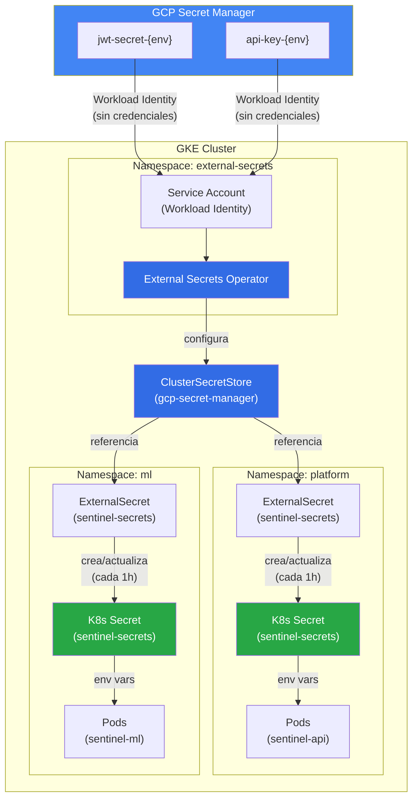
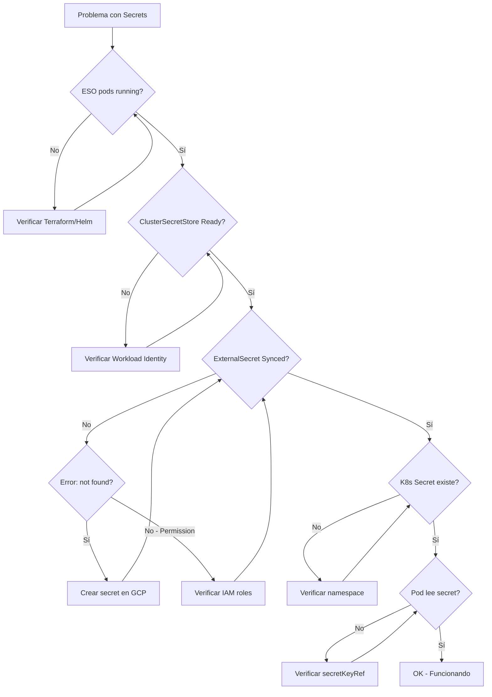

# Troubleshooting: External Secrets Operator

Guía de resolución de problemas comunes con External Secrets Operator (ESO) en Sentinel Platform.

## Diagrama de Flujo de Secrets



## Diagnóstico Rápido

Ejecuta estos comandos para diagnosticar el estado del sistema:

```bash
# 1. Estado general
kubectl get pods -n external-secrets
kubectl get clustersecretstore
kubectl get externalsecrets -A

# 2. Detalles de errores
kubectl describe clustersecretstore gcp-secret-manager
kubectl describe externalsecret sentinel-secrets -n platform
kubectl describe externalsecret sentinel-secrets -n ml

# 3. Logs de ESO
kubectl logs -n external-secrets -l app.kubernetes.io/name=external-secrets --tail=100
```

## Problemas Comunes

---

### 1. ESO No Está Corriendo

**Síntomas:**
```bash
$ kubectl get pods -n external-secrets
No resources found in external-secrets namespace.
```

**Causas Posibles:**
- Terraform no se aplicó correctamente
- El namespace no existe
- Helm release falló

**Solución:**

```bash
# Verificar namespace
kubectl get namespace external-secrets

# Si no existe, verificar Terraform
cd infra/terraform/environments/dev
terraform plan
terraform apply

# Si Terraform ya se aplicó, verificar Helm
helm list -n external-secrets

# Reinstalar ESO manualmente si es necesario
helm repo add external-secrets https://charts.external-secrets.io
helm install external-secrets external-secrets/external-secrets \
  -n external-secrets --create-namespace
```

---

### 2. ClusterSecretStore en Estado "NotReady"

**Síntomas:**
```bash
$ kubectl get clustersecretstore
NAME                  AGE   STATUS   CAPABILITIES   READY
gcp-secret-manager    5m    Error    -              False
```

**Diagnóstico:**
```bash
kubectl describe clustersecretstore gcp-secret-manager
```

**Causa: Workload Identity no configurado**

```
Events:
  Type     Reason  Message
  ----     ------  -------
  Warning  Error   could not get credentials: google: could not find default credentials
```

**Solución:**

```bash
# 1. Verificar Service Account de ESO tiene anotación de Workload Identity
kubectl get serviceaccount external-secrets -n external-secrets -o yaml | grep -A5 annotations

# Esperado:
# annotations:
#   iam.gke.io/gcp-service-account: sentinel-eso-dev@PROJECT_ID.iam.gserviceaccount.com

# 2. Verificar binding de Workload Identity en GCP
gcloud iam service-accounts get-iam-policy \
  sentinel-eso-dev@PROJECT_ID.iam.gserviceaccount.com

# Esperado: member con serviceAccount:PROJECT_ID.svc.id.goog[external-secrets/external-secrets]

# 3. Si falta, reaplicar Terraform
terraform apply -target=module.kubernetes
```

**Causa: Service Account no tiene permisos**

```
Events:
  Type     Reason  Message
  ----     ------  -------
  Warning  Error   permission denied on resource project
```

**Solución:**

```bash
# Verificar rol secretAccessor
gcloud projects get-iam-policy PROJECT_ID \
  --flatten="bindings[].members" \
  --filter="bindings.role:roles/secretmanager.secretAccessor" \
  --format="table(bindings.members)"

# Si falta, añadir manualmente
gcloud projects add-iam-policy-binding PROJECT_ID \
  --member="serviceAccount:sentinel-eso-dev@PROJECT_ID.iam.gserviceaccount.com" \
  --role="roles/secretmanager.secretAccessor"
```

---

### 3. ExternalSecret en Estado "SecretSyncedError"

**Síntomas:**
```bash
$ kubectl get externalsecrets -n platform
NAME              STORE                REFRESH   STATUS             READY
sentinel-secrets  gcp-secret-manager   1h        SecretSyncedError  False
```

**Diagnóstico:**
```bash
kubectl describe externalsecret sentinel-secrets -n platform
```

**Causa: Secret no existe en GCP**

```
Events:
  Type     Reason        Message
  ----     ------        -------
  Warning  UpdateFailed  secret jwt-secret-dev not found
```

**Solución:**

```bash
# Listar secrets existentes
gcloud secrets list --project=PROJECT_ID

# Crear el secret si no existe
gcloud secrets create jwt-secret-dev --project=PROJECT_ID

# Añadir un valor
echo -n "mi-valor-secreto" | gcloud secrets versions add jwt-secret-dev \
  --data-file=- --project=PROJECT_ID
```

**Causa: Secret existe pero no tiene versiones**

```
Events:
  Type     Reason        Message
  ----     ------        -------
  Warning  UpdateFailed  secret jwt-secret-dev has no versions
```

**Solución:**

```bash
# Verificar versiones
gcloud secrets versions list jwt-secret-dev --project=PROJECT_ID

# Añadir primera versión
echo -n "mi-valor" | gcloud secrets versions add jwt-secret-dev \
  --data-file=- --project=PROJECT_ID
```

---

### 4. K8s Secret No Se Crea

**Síntomas:**
```bash
$ kubectl get secret sentinel-secrets -n platform
Error from server (NotFound): secrets "sentinel-secrets" not found
```

Pero ExternalSecret muestra `SecretSynced`:
```bash
$ kubectl get externalsecrets -n platform
NAME              STORE                REFRESH   STATUS         READY
sentinel-secrets  gcp-secret-manager   1h        SecretSynced   True
```

**Causa: Namespace incorrecto**

Verifica que el ExternalSecret está en el namespace correcto:

```bash
kubectl get externalsecrets -A
```

**Solución:**

```bash
# Verificar que los namespaces existen
kubectl get namespace platform
kubectl get namespace ml

# Si no existen, créalos
kubectl create namespace platform
kubectl create namespace ml

# O aplica Kustomize que los crea
kubectl apply -k k8s/overlays/dev
```

---

### 5. Pod No Puede Leer Secret

**Síntomas:**
```bash
$ kubectl logs deployment/sentinel-api -n platform
Error: environment variable JWT_SECRET not set
```

**Diagnóstico:**

```bash
# Verificar que el secret existe
kubectl get secret sentinel-secrets -n platform

# Verificar las keys del secret
kubectl get secret sentinel-secrets -n platform -o jsonpath='{.data}' | jq

# Verificar la configuración del deployment
kubectl get deployment sentinel-api -n platform -o yaml | grep -A20 "env:"
```

**Causa: Nombre de key incorrecto**

El deployment referencia `jwt-secret` pero el secret tiene `JWT_SECRET`.

**Solución:**

Verifica que los nombres coincidan:

```yaml
# En deployment
env:
  - name: JWT_SECRET
    valueFrom:
      secretKeyRef:
        name: sentinel-secrets
        key: jwt-secret  # <-- Este debe coincidir con la key en el secret
```

```bash
# Verificar key en el secret
kubectl get secret sentinel-secrets -n platform -o jsonpath='{.data}' | jq 'keys'
# Esperado: ["api-key", "jwt-secret"]
```

---

### 6. Secrets No Se Actualizan

**Síntomas:**
Actualizaste el secret en GCP pero el pod sigue usando el valor antiguo.

**Causa: RefreshInterval no ha pasado**

Por defecto, ESO sincroniza cada 1 hora.

**Solución Inmediata:**

```bash
# Opción 1: Forzar sync con anotación
kubectl annotate externalsecret sentinel-secrets -n platform \
  force-sync=$(date +%s) --overwrite

# Opción 2: Eliminar y recrear el secret (ESO lo recreará)
kubectl delete secret sentinel-secrets -n platform

# Esperar a que ESO sincronice (~30 segundos)
sleep 30
kubectl get secret sentinel-secrets -n platform
```

**Nota:** Los pods NO recargan automáticamente los secrets. Después de actualizar, reinicia los pods:

```bash
kubectl rollout restart deployment/sentinel-api -n platform
```

---

### 7. Error "provider not found: gcpsm"

**Síntomas:**
```
Events:
  Type     Reason        Message
  ----     ------        -------
  Warning  UpdateFailed  provider not found: gcpsm
```

**Causa:** ESO no tiene soporte para GCP Secret Manager.

**Solución:**

```bash
# Verificar versión de ESO
helm list -n external-secrets

# Actualizar a versión con soporte GCP
helm upgrade external-secrets external-secrets/external-secrets \
  -n external-secrets \
  --set installCRDs=true
```

---

### 8. Error de Timeout al Crear ClusterSecretStore

**Síntomas:**
```
Error: timed out waiting for the condition
```

**Causa:** ESO CRDs no están instalados o listos.

**Solución:**

```bash
# Verificar CRDs
kubectl get crd | grep external-secrets

# Esperado:
# clustersecretstores.external-secrets.io
# externalsecrets.external-secrets.io
# secretstores.external-secrets.io

# Si faltan, reinstalar ESO con CRDs
helm upgrade --install external-secrets external-secrets/external-secrets \
  -n external-secrets \
  --set installCRDs=true \
  --wait
```

---

## Comandos de Diagnóstico Avanzado

### Ver eventos de ESO

```bash
kubectl get events -n external-secrets --sort-by='.lastTimestamp'
```

### Ver logs detallados de ESO

```bash
# Controller
kubectl logs -n external-secrets -l app.kubernetes.io/name=external-secrets -c manager

# Webhook
kubectl logs -n external-secrets -l app.kubernetes.io/name=external-secrets-webhook
```

### Verificar conectividad con GCP

```bash
# Crear pod de debug
kubectl run debug --rm -it --image=google/cloud-sdk:slim -n external-secrets -- bash

# Dentro del pod
gcloud auth list
gcloud secrets list --project=PROJECT_ID
```

### Verificar Workload Identity desde dentro del cluster

```bash
# Crear pod con SA de ESO
kubectl run wi-test --rm -it \
  --image=google/cloud-sdk:slim \
  --serviceaccount=external-secrets \
  -n external-secrets \
  -- bash

# Dentro del pod
gcloud auth list
# Debería mostrar el service account de GCP

gcloud secrets versions access latest --secret=jwt-secret-dev --project=PROJECT_ID
# Debería mostrar el valor del secret
```

## Diagrama de Flujo de Troubleshooting



## Contacto y Soporte

Si después de seguir esta guía el problema persiste:

1. Recopila la información de diagnóstico:
   ```bash
   kubectl get pods -n external-secrets -o yaml > eso-pods.yaml
   kubectl describe clustersecretstore gcp-secret-manager > css-describe.txt
   kubectl describe externalsecrets -A > es-describe.txt
   kubectl logs -n external-secrets -l app.kubernetes.io/name=external-secrets > eso-logs.txt
   ```

2. Abre un issue en el repositorio con:
   - Descripción del problema
   - Pasos para reproducir
   - Archivos de diagnóstico recopilados
   - Versión de ESO (`helm list -n external-secrets`)
   - Versión de Terraform (`terraform version`)
